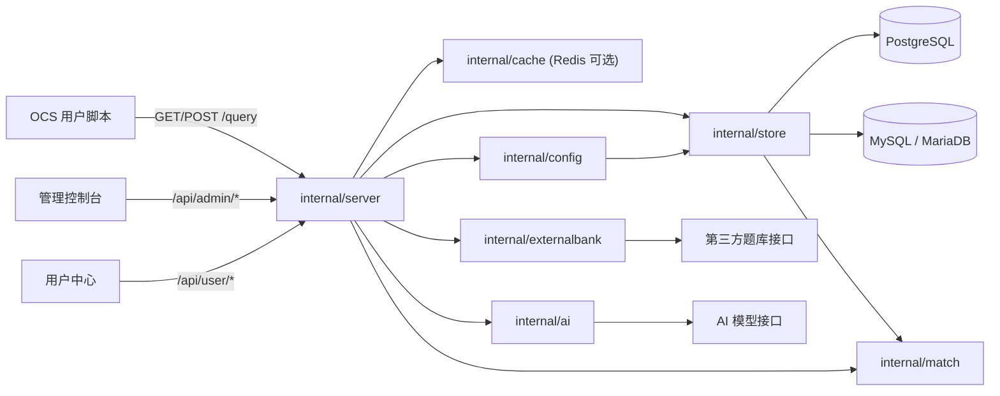
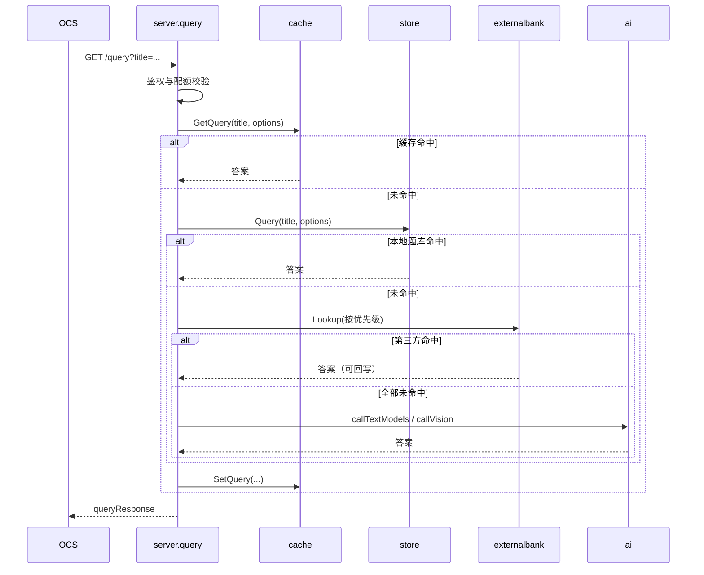

# nfentik-go 系统架构

## 概述

nfentik-go 是 ZError 的 Go 语言服务端实现，把原本的 Tauri 桌面 AI 题库软件改造成可在服务器上部署的网页服务。它让 OCS 网课助手用户通过一个 HTTP 接口查询题目答案：命中本地题库直接返回；本地未命中时先按优先级调用可配置的第三方题库接口，仍未命中再调用自定义 AI 模型，并把结果回写题库。管理控制台与用户中心的前端资源通过 Go `embed` 内嵌，最终产物是单文件二进制。

系统面向题库运营者与普通用户：运营者通过控制台维护题库、文件夹、用户与套餐、模型与第三方题库配置；普通用户凭令牌登录用户中心查看额度与调用记录。数据层同时支持 PostgreSQL 与 MySQL/MariaDB，Redis 可选用于查询缓存、每日计数与日志缓冲。

## 技术栈

**语言与运行时**
- Go 1.25（CGO 必需：gojieba 中文分词、go-sqlite3 旧库迁移）

**框架与库**
- `net/http` + `html/template` 提供 HTTP 服务与控制台页面
- `github.com/jackc/pgx/v5` PostgreSQL 驱动
- `github.com/go-sql-driver/mysql` MySQL/MariaDB 驱动
- `github.com/redis/go-redis/v9` Redis 客户端
- `github.com/yanyiwu/gojieba` 中文分词
- `github.com/mattn/go-sqlite3` 旧版 SQLite 数据迁移

**数据存储**
- PostgreSQL 13+ 或 MySQL 5.7+ / MariaDB 10.2+（二选一）
- Redis 6+（可选：查询缓存、每日计数、请求日志队列）
- 本地引导配置 `config/config.json`（仅连接串）

**基础设施**
- 单二进制部署；Linux `tar.gz` 与 Windows `zip` 发布包
- systemd / WinSW / nssm 进程托管

## 项目结构

```
nfentik-go/
├── main.go                 # 入口：服务启动 + migrate-sqlite / check-db 子命令
├── internal/
│   ├── server/             # HTTP 服务、路由、控制台与用户中心
│   ├── store/              # 数据存储（PostgreSQL / MySQL 方言层）
│   ├── externalbank/       # 第三方题库 HTTP 适配器
│   ├── ai/                 # AI 模型调用与结果解析
│   ├── cache/              # Redis 查询缓存、计数与日志队列
│   ├── match/              # 题目匹配算法（jieba 分词）
│   ├── plan/               # 套餐与状态判定
│   ├── config/             # 引导配置与数据库配置读写
│   └── importer/           # 旧 SQLite 数据迁移
├── web/
│   ├── templates/          # 控制台 / 用户中心 / 安装向导模板（内嵌）
│   └── static/             # 内嵌 JS / CSS
└── scripts/packaging/      # Linux / Windows 打包脚本与安装资产
```

**入口点**
- `main.go` - 服务启动、子命令分发
- `internal/server/server.go` - HTTP 路由注册（`Server.Handler`）
- `internal/server/query.go` - `/query` 查询解析链路

## 子系统

### 查询服务
**目的**: 解析 OCS 的 `/query` 请求并返回答案
**位置**: `internal/server/`
**关键文件**: `query.go`, `server.go`
**依赖**: `store`, `externalbank`, `ai`, `cache`, `match`, `plan`
**被依赖**: 无（对外入口）

### 数据存储
**目的**: 题库、文件夹、日志、用户、设置与模型/第三方题库配置的持久化
**位置**: `internal/store/`
**关键文件**: `store.go`, `migrate.go`, `dialect.go`, `users.go`, `logs.go`, `settings_repo.go`
**依赖**: `match`
**被依赖**: `server`, `config`, `importer`

### 第三方题库适配
**目的**: 把可配置的外部 HTTP 接口转成统一的题库查询
**位置**: `internal/externalbank/`
**关键文件**: `externalbank.go`, `client.go`
**依赖**: 标准库 `net/http`
**被依赖**: `server`

### AI 模型调用
**目的**: 本地与第三方都未命中时，调用配置的文本/视觉模型产出答案
**位置**: `internal/ai/`
**关键文件**: `ai.go`, `models.go`, `prompt.go`, `validate.go`
**依赖**: 无（HTTP 调用 OpenAI 兼容接口）
**被依赖**: `server`

### 缓存与计数
**目的**: Redis 查询缓存、每日请求计数、请求日志缓冲；不可用时退化直连数据库
**位置**: `internal/cache/`
**关键文件**: `cache.go`
**依赖**: `store`（通过注入的 sink 回调）
**被依赖**: `server`

### 题目匹配
**目的**: 精确哈希命中 + 模糊相似度评分，供查询与第三方答案校验复用
**位置**: `internal/match/`
**关键文件**: `match.go`, `hash.go`
**依赖**: `gojieba`
**被依赖**: `store`, `server`

## 图表




