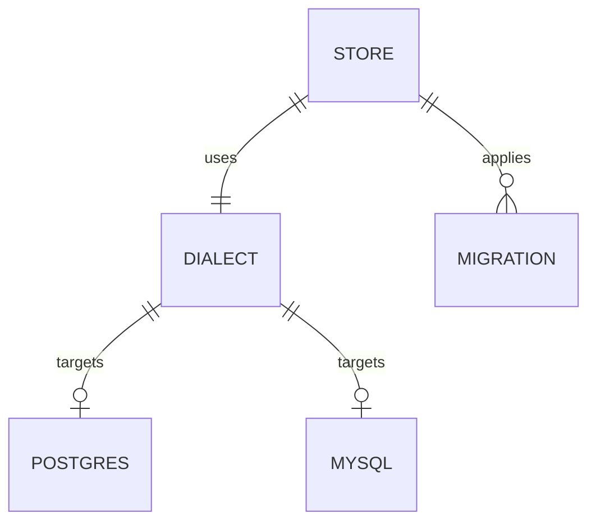

# 数据库方言

数据库方言（Database Dialect）是 nfentik-go 在 PostgreSQL 与 MySQL/MariaDB 之间统一 SQL 的抽象层。查询统一用 `$n` 占位符书写，由方言层按目标引擎重绑与转换，从而让绝大部分存储代码与引擎无关。

## 什么是数据库方言？

方言层封装了两个引擎之间所有必要的差异：占位符风格、自增返回、冲突处理、大小写不敏感匹配、NULL 安全比较、时间格式化、递归遍历与 DDL 幂等策略。

**关键特征**
- 由连接串前缀自动识别引擎：`postgres://` / `mysql://`
- `$n` → `?` 的占位符重绑，并自动展开重复占位符的参数

## 代码位置

| 方面 | 位置 |
| --- | --- |
| 方言识别与片段 | `internal/store/dialect.go` |
| 查询重绑辅助 | `internal/store/dialect.go`（`rebind` / `queryOn` / `queryRowOn` / `execOn`） |
| 连接建立 | `internal/store/dialect.go`（`openDB` / `openMySQL`） |
| 建表与迁移 | `internal/store/migrate.go` |

## 主要差异一览

| 能力 | PostgreSQL | MySQL / MariaDB |
| --- | --- | --- |
| 占位符 | `$1` | `?`（重绑） |
| 插入取回主键 | `RETURNING Id` | `LastInsertId()` |
| Upsert | `ON CONFLICT ... DO UPDATE` | `ON DUPLICATE KEY UPDATE` |
| NULL 安全比较 | `IS NOT DISTINCT FROM` | `<=>` |
| 大小写不敏感匹配 | `ILIKE` | `LOWER(col) LIKE LOWER(?)` |
| 时间格式化 | `to_char` | `DATE_FORMAT` |
| 幂等 DDL | `ADD COLUMN IF NOT EXISTS` | `information_schema` 检查后执行 |
| 自引用删除 | 直接子查询 | 派生表包裹 |

## 不变量

1. **一致的行为**：同一逻辑操作在两种引擎上产生等价结果。
2. **占位符唯一风格**：源码中只写 `$n`，MySQL 的 `?` 由 `rebind` 生成。
3. **迁移前向单向**：迁移只追加、版本严格递增，不回滚。
4. **不丢数据**：迁移与结构修复不删除或重建已有数据。

## 关系

| 关联概念 | 关系 | 描述 |
| --- | --- | --- |
| [查询链路](./查询链路.md) | 被支撑 | 本地匹配与回写依赖方言层 |
| [第三方题库源](./第三方题库源.md) | 被支撑 | 回写经方言层写入 |
