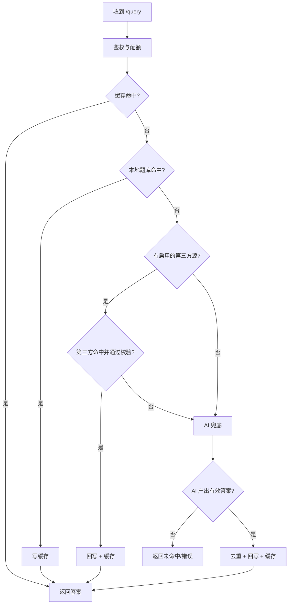
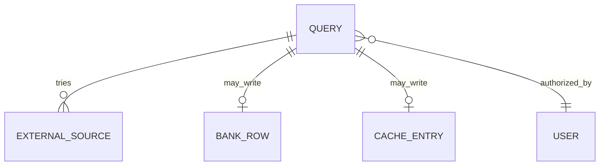

# 查询链路

查询链路是 nfentik-go 处理一次 `/query` 请求的解析顺序：Redis 缓存 → 本地题库 → 第三方题库 → AI 模型。它决定了答案从哪里来、何时回写以及如何标记来源。

## 什么是查询链路？

查询链路把多个答案来源按代价从低到高串联：先查最便宜的缓存，再查本地题库，然后按优先级调用第三方题库，最后才调用成本最高的 AI 模型。任一步命中即返回，命中结果可回写题库与缓存。

**关键特征**
- 分层短路：命中即返回，避免不必要的下游调用
- 单飞合并：相同题目并发请求合并为一次解析（`singleflight` 风格）
- 携带 URL 的题目跳过缓存，并走视觉模型
- 来源标记：`cache` / `bank` / `external:<name>` / `ai`

## 代码位置

| 方面 | 位置 |
| --- | --- |
| 入口 | `internal/server/query.go`（`handleQuery`） |
| 链路 | `internal/server/query.go`（`resolveQueryUncached`） |
| 单飞 | `internal/server/query.go`（`resolveShared`） |
| 本地匹配 | `internal/store/store.go`、`internal/match/` |
| 第三方 | `internal/externalbank/` |
| AI | `internal/ai/` |
| 缓存 | `internal/cache/cache.go` |

## 阶段

| 顺序 | 阶段 | 命中来源标记 | 说明 |
| --- | --- | --- | --- |
| 0 | 鉴权与配额 | - | `authorizeQuery` 校验 usertoken 与套餐状态 |
| 1 | Redis 缓存 | `cache` | 命中即返回，不落库；URL 题目跳过 |
| 2 | 本地题库 | `bank` | 精确哈希 → 模糊候选；命中写缓存 |
| 3 | 第三方题库 | `external:<name>` | 按 `priority` 顺序，首个通过校验即命中；仅精确题干回写 |
| 4 | AI 模型 | `ai` | 文本或视觉模型；选项校验、去重后回写并缓存 |

## 不变量

1. **短路**：任一步命中后不再调用后续阶段。
2. **无源不变**：未配置第三方题库时链路与历史一致。
3. **不污染**：空答案、不可信答案、低相似度第三方结果不得写入题库与缓存。
4. **去重**：回写复用 `FindByNormalizedQuestion`，不产生等价重复行。
5. **并发合并**：同一 `LookupKey` 的并发请求共享一次解析结果。
6. **答案隔离**：`QuestionHash` 同时包含归一化题面与排序后的 URL 集合，不同图片题目不会共享哈希、缓存或题库行。
7. **选项校验**：单选、多选与带选项的未知题型，AI/第三方答案必须解析到某个选项文字；翻译、复述题干和无关散文拒绝入库。
8. **第三方精确回写**：只有题干完全一致（含 URL 集合）的第三方结果才允许回写与缓存；近似命中只返回给当前请求。
9. **库缓存一致**：并发写入导致答案未落库时，返回与缓存使用题库实际保存的答案，保证不同请求看到同一答案。

## 答案隔离与校验

- `match.QuestionHash` 对归一化题面追加排序后的 URL 摘要；`NormalizerVersion=3` 会在升级后重算一次全库哈希。
- `ai.ValidateAnswer` 根据题型校验答案：单选题接受选项字母或选项文字；多选题支持 `###`、逗号、换行和连写字母；判断题归一为「正确/错误」；填空与简答保留原文但过滤拒答。
- 第三方答案先经过 `ValidateAnswer`，再判断题干是否完全一致；近似匹配只服务当前请求，不回写题库与缓存。
- AI 回写后重新读取题库行作为返回值与缓存内容，避免并发写入时缓存与库中答案不一致。

## 生命周期

## 关系

| 关联概念 | 关系 | 描述 |
| --- | --- | --- |
| [第三方题库源](./第三方题库源.md) | 使用 | 链路第 3 阶段 |
| [用户令牌与套餐](./用户令牌与套餐.md) | 依赖 | 鉴权与配额在链路前完成 |
| [数据库方言](./数据库方言.md) | 依赖 | 本地匹配与回写经存储层 |
