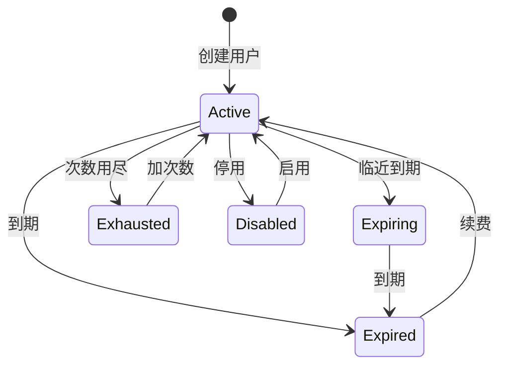
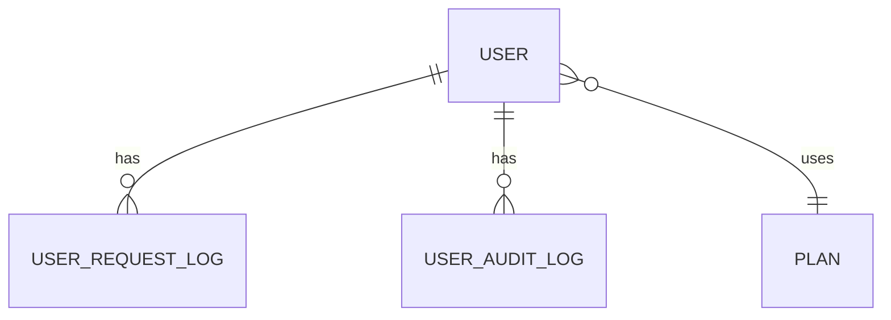

# 用户令牌与套餐

用户令牌与套餐体系为 nfentik-go 提供普通用户维度：管理员在控制台创建用户并生成唯一 `usertoken`，为其选择时长或次数套餐；用户凭令牌调用 `/query` 并登录用户中心查看额度与记录。

## 什么是用户令牌与套餐？

`usertoken` 是普通用户的唯一身份与调用凭据；套餐（Plan）决定该用户的可用额度与有效期。每次 `/query` 调用扣减一次配额，命中缓存或题库同样扣减。

**关键特征**
- 令牌全局唯一，前缀通常为 `nf_`，可被管理员重置（旧令牌立即失效）
- 两类套餐：时长套餐（按有效期）与次数套餐（按剩余次数）
- 状态：`active`、`expiring`、`expired`、`exhausted`、`disabled`
- 鉴权由设置 `usersEnabled` / `requireTokenForQuery` 控制

## 代码位置

| 方面 | 位置 |
| --- | --- |
| 模型/仓储 | `internal/store/users.go` |
| 套餐与状态 | `internal/plan/plan.go` |
| 鉴权 | `internal/server/query.go`（`authorizeQuery`）、`internal/server/user_auth.go` |
| 管理接口 | `internal/server/admin_users.go` |
| 数据表 | `Users`、`UserRequestLogs`、`UserAuditLogs` |

## 结构

```go
type User struct {
    ID          int64
    Token       string   // usertoken，唯一身份
    PlanType    string   // duration | count
    PlanCode    string   // monthly|quarterly|half_year|yearly|unlimited|duration_custom|count
    PlanLabel   string
    StartAt     string
    ExpireAt    *string  // nil 表示无到期时间
    TotalCount  *int64   // 次数套餐总次数
    UsedCount   int64
    RemainCount *int64   // 次数套餐剩余次数
    Note        string
    Enabled     bool
    CreatedAt   string
    UpdatedAt   string
}
```

### 关键字段

| 字段 | 类型 | 描述 | 约束 |
| --- | --- | --- | --- |
| `Token` | `string` | 唯一身份 | 全局唯一，重置后旧值失效 |
| `PlanType` | `string` | 套餐类型 | `duration` 或 `count` |
| `ExpireAt` | `*string` | 到期时间 | 空表示不过期 |
| `RemainCount` | `*int64` | 剩余次数 | 次数套餐用；时长套餐为空 |

## 不变量

1. **唯一性**：`usertoken` 在所有用户中唯一。
2. **配额扣减**：每次 `/query` 对次数套餐扣减 `RemainCount` 一次；时长/无限套餐只累加 `UsedCount`。
3. **状态决定可用性**：`expired` / `exhausted` / `disabled` 时拒绝查询。
4. **审计**：令牌或套餐变更写入 `UserAuditLogs`。

## 生命周期



### 状态描述

| 状态 | 描述 | 允许的转换 |
| --- | --- | --- |
| `active` | 正常可用 | → expiring, exhausted, expired, disabled |
| `expiring` | 临近到期 | → expired |
| `expired` | 已过期 | → active（续费） |
| `exhausted` | 次数用尽 | → active（加次数） |
| `disabled` | 被停用 | → active |

## 关系



| 关联概念 | 关系 | 描述 |
| --- | --- | --- |
| Plan | 使用 | 每个用户持有一个套餐 |
| [查询链路](./查询链路.md) | 被约束 | 每次查询扣减用户配额 |
