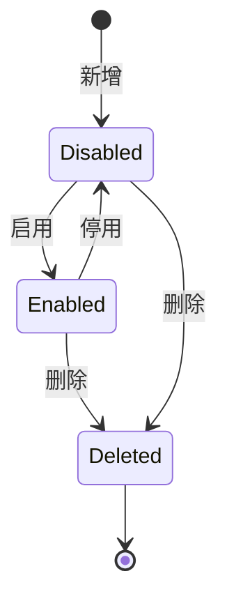
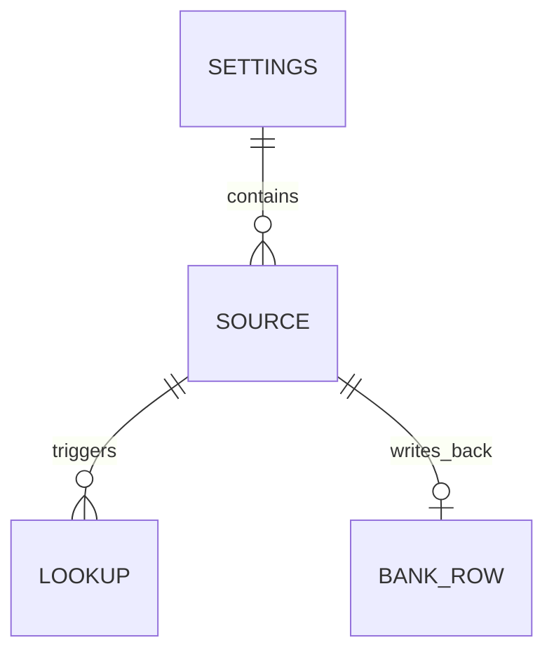

# 第三方题库源

第三方题库源（External Bank Source）是管理员在控制台配置的一个外部 HTTP 题库接口，用于在本地题库未命中时按题目查询答案。它使服务无需改代码即可对接任意 JSON 形态的第三方题库。

## 什么是第三方题库源？

第三方题库源代表一个可配置的外部答案来源。查询时服务把题目按源定义的模板转换为 HTTP 请求，并把响应中的指定字段解析为答案。

**关键特征**
- 与查询题目一一对应：发送题目、取回答案，而非本地相似度匹配
- 支持 GET 与 POST（JSON / 表单）
- 地址、参数与请求体支持 `{question}`、`{options}`、`{type}` 占位符
- 按 `priority` 升序调用，首个通过校验的命中即返回
- 可选回写本地题库与查询缓存

## 代码位置

| 方面 | 位置 |
| --- | --- |
| 配置类型 | `internal/externalbank/externalbank.go` |
| HTTP 适配器 | `internal/externalbank/client.go` |
| 配置读写 | `internal/config/config.go`（`ExternalBanks` / `SaveExternalBanks`） |
| 链路接入 | `internal/server/query.go`（`externalSources` / `lookupExternal` / `acceptExternal` / `respondExternal`） |
| 管理接口 | `internal/server/admin.go`（`adminExternalBanks`） |
| 配置存储 | 数据库 `AppSettings` 表键 `external_banks` |

## 结构

```go
type Source struct {
    ID             string            // 唯一标识
    Name           string            // 显示名称（用于日志来源标记）
    Enabled        bool              // 是否启用
    Priority       int               // 越小越先调用
    URL            string            // 请求地址（含占位符）
    Method         string            // GET | POST
    Headers        map[string]string // 自定义请求头（含鉴权）
    QueryParams    map[string]string // GET 参数模板
    BodyTemplate   string            // POST 请求体模板
    ContentType    string            // application/json | form
    AnswerPath     string            // 答案字段路径，如 data.answer
    QuestionPath   string            // 可选，返回题目用于校验
    TimeoutSeconds int               // 单源超时
    Trust          bool              // 跳过相似度校验
    WriteBack      bool              // 命中后是否回写本地题库
    CacheTTL       int               // 覆盖全局缓存 TTL
}
```

### 关键字段

| 字段 | 类型 | 描述 | 约束 |
| --- | --- | --- | --- |
| `URL` | `string` | 请求地址 | 必填，合法 http/https |
| `AnswerPath` | `string` | 答案提取路径 | 为空时按 `data.answer`→`answer`→`data` 回退 |
| `Trust` | `bool` | 信任模式 | 为真时跳过题目相似度校验 |
| `WriteBack` | `bool` | 回写开关 | 为真时命中写入本地题库 |
| `Priority` | `int` | 调用顺序 | 升序 |

## 不变量

1. **合法性**：保存时 `Name`、`URL` 非空且 URL 合法（`ValidURL`）。
2. **可采信**：被采用的答案非空、非不可信占位，且（非 Trust 时）返回题目与查询相似度 ≥ 0.72。
3. **不回写重名**：回写复用 `FindByNormalizedQuestion` 去重，不产生与本地等价的重复行。
4. **来源可追溯**：命中来源在日志与用户记录中标记为 `external:<name>`。

## 生命周期



### 状态描述

| 状态 | 描述 | 允许的转换 |
| --- | --- | --- |
| `disabled` | 已配置但不参与查询 | → enabled, deleted |
| `enabled` | 参与查询链路 | → disabled, deleted |
| `deleted` | 从配置移除 | （终态） |

## 关系



| 关联概念 | 关系 | 描述 |
| --- | --- | --- |
| [查询链路](./查询链路.md) | 被包含 | 第三方源是查询链路中的一个阶段 |
| [数据库方言](./数据库方言.md) | 依赖 | 回写经存储层写入 AIResponses 表 |
