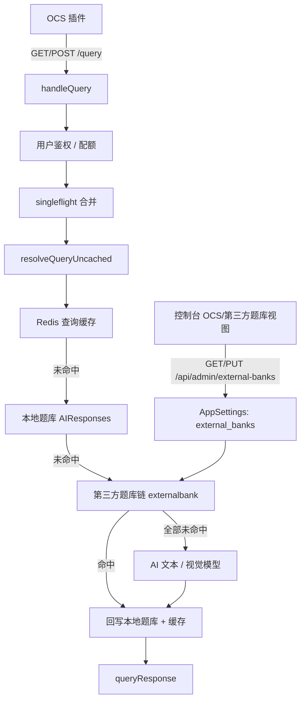

# 第三方题库接口接入设计

Feature Name: external-question-bank
Updated: 2026-10-13

## Description

在 nfentik-go 的 `/query` 解析链路中，于「本地题库未命中」与「AI 兜底」之间插入「第三方题库」来源。管理员在控制台以可视化方式配置一个或多个第三方题库源（地址、请求映射、响应提取、超时、优先级、是否回写），查询时按优先级顺序调用，命中即返回，可选回写本地题库与缓存；全部未命中原样进入既有 AI 兜底流程。

设计目标是零代码接入任意 JSON 形态的题库接口，并复用现有模型配置的管理范式（存于 `AppSettings`、控制台编辑、日志脱敏）。

## 决策记录

- **接口形态**：通用可配置适配器（地址 + 占位符 + 响应路径），兼容 GET/POST，不针对某个具体第三方协议定制。
- **链路位置与回写**：位于本地题库未命中之后、AI 之前；命中即回写本地题库与查询缓存。
- **多源与校验**：按 `Priority` 顺序调用，首个通过校验的命中即返回；非信任模式使用本地 `match.Score` 相似度校验（阈值 0.72）。

## Architecture



解析顺序（未改动的前半段省略）：

1. Redis 查询缓存（含 URL 的题目跳过）。
2. 本地题库 `store.Query`（精确哈希 → 模糊候选）。
3. **第三方题库链**：按 `Priority` 升序，逐个调用启用的源；命中并通过校验即返回。
4. AI 文本 / 视觉模型兜底。

任一步命中后都走既有的「回写 / 缓存 / 渲染」流程，保持 `queryResponse` 与 `bankAnswer` 结构不变。

## Components and Interfaces

### 1. 配置模型与存储 `internal/externalbank`

新增包 `internal/externalbank`，负责配置结构与 HTTP 适配。

```go
// Source 是一个第三方题库源的接入配置。
type Source struct {
    ID             string            `json:"id"`
    Name           string            `json:"name"`
    Enabled        bool              `json:"enabled"`
    Priority       int               `json:"priority"`
    URL            string            `json:"url"`
    Method         string            `json:"method"`         // GET | POST
    Headers        map[string]string `json:"headers"`
    QueryParams    map[string]string `json:"queryParams"`    // GET 参数模板
    BodyTemplate   string            `json:"bodyTemplate"`   // POST JSON/表单模板
    ContentType    string            `json:"contentType"`    // application/json | form
    AnswerPath     string            `json:"answerPath"`     // 可选，点号路径；留空则自动识别
    QuestionPath   string            `json:"questionPath"`   // 可选，留空则自动识别回显题目
    TimeoutSeconds int               `json:"timeoutSeconds"` // 默认 10
    Trust          bool              `json:"trust"`          // 跳过相似度校验
    WriteBack      bool              `json:"writeBack"`
    CacheTTL       int               `json:"cacheTTL"`       // 秒，0 用全局
}

// Settings 是全部题库源的集合。
type Settings struct {
    Sources []Source `json:"sources"`
}

// Query 是适配器输入。
type Query struct {
    Title   string
    Options *string
    Type    *string
}

// Result 是适配器输出。
type Result struct {
    Answer   string
    Question string // 可能为空
}

// Client 执行一次 Lookup。
type Client struct{ http *http.Client }

func (c *Client) Lookup(ctx context.Context, src Source, q Query) (Result, error)

// Parse 解析数据库中的 external_banks 文档。
func Parse(raw json.RawMessage) (Settings, error)

// Enabled 返回按 Priority 升序、仅启用且 URL 合法的源。
func (s Settings) Enabled() []Source
```

模板渲染：`URL`、`QueryParams` 的值、`BodyTemplate` 中支持占位符 `{question}`、`{options}`、`{type}`，其中 `{options}`/`{type}` 缺失时替换为空串，并对 URL 场景做百分号编码。

响应提取：`AnswerPath` 优先；为空或未取到答案时自动识别——对响应 JSON 做广度优先遍历，命中常见答案键（`answer/anwser/correctAnswer/correct/data/result/content/text/value/output/body/detail/solution` 等），取最浅、最靠前的有效值，支持嵌套对象、数组（多值用 `###` 连接）与数字答案，键名大小写不敏感，并排除 `code/status/msg/message/success/time/total/calls/type` 等状态字段、过滤 `success/ok/成功` 等占位词（最大深度 5）。题目回显同样自动识别（键 `q/question/query/title` 等），未配置 `QuestionPath` 时也能做相似度校验。

### 2. 配置读写 `internal/config`

在 `config.Store` 上新增与模型配置对称的方法：

```go
func (s *Store) ExternalBanks() (json.RawMessage, error)
func (s *Store) SaveExternalBanks(raw json.RawMessage) error
```

底层使用 `AppSettings` 表中新键 `external_banks`，与现有 `model_config` 一致，复用 SettingsRepo 的 upsert。

### 3. 查询链路接入 `internal/server/query.go`

在 `resolveQueryUncached` 的本地题库未命中分支之后、`ModelSettings` 之前插入：

```go
if srcs := s.externalSources(); len(srcs) > 0 {
    for _, src := range srcs {
        result, err := s.lookupExternal(ctx, src, req)
        if err != nil {
            s.PublishError("external bank %s: %v", src.Name, err)
            continue
        }
        answer, ok := s.acceptExternal(src, req, result)
        if !ok {
            continue
        }
        return s.persistAndRespond(req, src, answer, hasURL) // 回写 + 缓存 + 返回
    }
}
```

- `externalSources()` 解析 `config.ExternalBanks()` 并返回 `Settings.Enabled()`；解析失败时记录日志并按空处理（不阻断链路）。
- `acceptExternal` 执行空答案过滤、不可信答案识别与相似度校验（`match.Score` ≥ 0.72，`Trust` 为真时跳过）。
- `persistAndRespond` 在 `WriteBack` 为真时复用去重逻辑写入本地题库，并写缓存，返回 `source = "external:" + src.Name`。

回写复用现有 `FindByNormalizedQuestion` 去重，避免与 AI 路径产生重复行。

### 4. 数据模型 `internal/store`

`AIResponses` 增加来源列，用于区分本地/AI/第三方：

```sql
-- migration v6
ALTER TABLE AIResponses ADD COLUMN Source VARCHAR(64) DEFAULT ''
```

- 新增 `InsertExternalResponse(question, answer, options, type, folderID, source)`，`IsAi=false`，`Source='external:<name>'`。
- 现有 `InsertAIResponse` 写入 `Source='ai'`；历史行为不变。
- OCS 响应结构不变；`Source` 仅用于控制台展示与审计。

若希望更小改动，可先复用 `InsertAIResponse` 并接受 `IsAi=true` 的语义近似，`Source` 列作为后续增强——本设计采用带 `Source` 列的方案以保证可审计性。

### 5. 控制台接口与页面

- 新增管理员接口：`GET/PUT /api/admin/external-banks`（读写配置）、`POST /api/admin/external-banks/test`（连通性测试，复用 `Lookup`）。
- 控制台新增「第三方题库」视图：源列表（增删改、启停、排序）、请求/响应映射编辑、测试连通性按钮。
- 无需改动用户页与 OCS 配置生成逻辑。

## Data Models

配置文档 `external_banks`（存于 `AppSettings`，结构见 `Settings`）：

```json
{
  "sources": [
    {
      "id": "src-1",
      "name": "示例题库",
      "enabled": true,
      "priority": 10,
      "url": "https://api.example.com/search?q={question}",
      "method": "GET",
      "headers": { "Authorization": "Bearer sk-xxx" },
      "answerPath": "data.answer",
      "questionPath": "data.question",
      "timeoutSeconds": 10,
      "trust": false,
      "writeBack": true,
      "cacheTTL": 0
    }
  ]
}
```

## Correctness Properties

- 无启用源时，查询链路与现状完全一致（缓存 → 本地 → AI）。
- 第三方命中优先于 AI，且先于更低优先级的源。
- 回写不产生与本地题库等价的重复行（依赖 `QuestionHash` 去重）。
- 单个源的耗时不超过其 `TimeoutSeconds`；顺序调用的总耗时为各源超时之和上界。
- 携带 URL 的题目对第三方源的处理与对视觉模型一致（不回写缓存）。
- 采信答案必为非空且（非 Trust 模式）通过相似度校验。

## Error Handling

| 场景 | 处理 |
| --- | --- |
| 源 URL 非法或配置解析失败 | 跳过该源，记录日志，不影响其他源与 AI |
| 请求超时 / 连接失败 / 非 2xx | 视为该源未命中，继续下一源 |
| 响应非 JSON / 提取路径缺失 | 视为未命中，记录原因 |
| 答案为空或不可信 | 丢弃，继续下一源 |
| 相似度低于阈值 | 丢弃，继续下一源 |
| 全部源失败/未命中 | 进入 AI 兜底 |
| 回写数据库失败 | 记录日志，仍返回已采信答案 |

## Test Strategy

- 适配器单测（`internal/externalbank`）：用 `httptest.Server` 覆盖 GET/POST、模板占位替换、点号路径提取、空/非法响应、超时。
- 配置单测：`Enabled()` 的排序与过滤、非法 URL 剔除、`Parse` 容错。
- 链路集成测（`internal/server`）：构造函数或测试用 `httptest` 源，验证「本地未命中 → 第三方命中 → 回写与缓存」、未命中时回落到 AI、`Trust` 与相似度校验分支。
- 存储测：`InsertExternalResponse` 去重与 `Source` 列写入。
- 回归：确保未配置源时既有 `/query` 行为不变。

## References

[^1]: (Filename#L322) - [resolveQueryUncached 查询链路](../nfentik-go/internal/server/query.go)
[^2]: (Filename#L36) - [ModelSettings 配置结构](../nfentik-go/internal/ai/models.go)
[^3]: (Filename) - [http server setup](https://pkg.go.dev/net/http)
