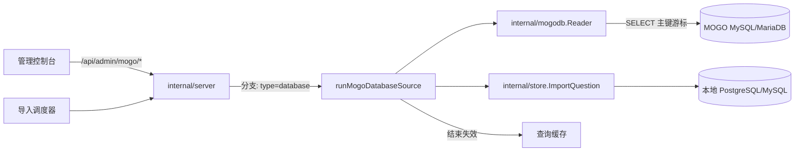
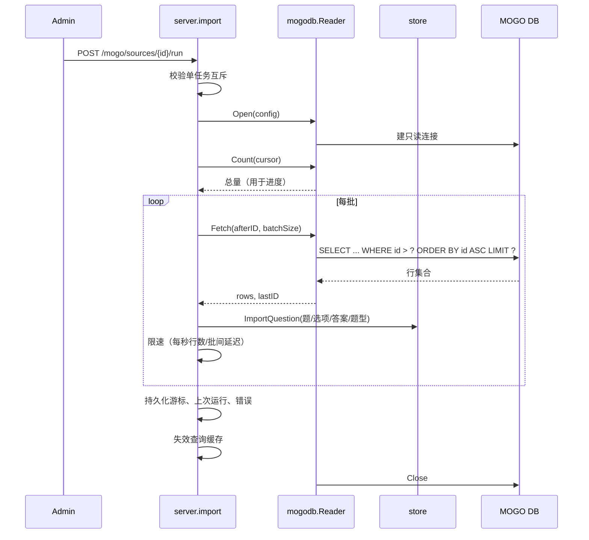

# MOGO 数据库直连导入

Feature Name: 2026-10-14-mogo-database-import
Updated: 2026-10-14

## Description

在现有 MOGO 导入能力上增加「数据库源」类型：管理员配置一条到 MOGO 主机 MySQL/MariaDB 的只读连接，nfentik-go 按主键游标升序分批 `SELECT` 题目表并写入本地题库。数据库源与 HTTP 源在同一控制台列表管理，复用导入任务的互斥、调度、进度、游标持久化与缓存失效，并新增以「每秒行数」为主的读取限速。

设计动机：HTTP 接口在数据量大或 MOGO 繁忙时返回 `502/503/504`，而数据库直连可用主键范围扫描稳定地按限速读取。

## 已确认决策

- 数据库导入写入本地题库的 `Source` 标记为 `import:mogo-db`，与 HTTP 导入的 `import:mogo` 区分。
- 增量游标复用现有 `maxId` 字段；数据库源按 `id` 升序从 `maxId` 续采（主键范围扫描，续采不重复）。
- 新建数据库源在控制台默认填入批次 500、每秒 100 行、批间延迟 0；`normalizeSource` 将批次收敛到 1–5000（`<= 0` 时置 500）、每秒行数负值收敛为 0；每秒行数 0 表示不限速。

## Architecture





## Components and Interfaces

### 新增包 `internal/mogodb`

封装到 MOGO 数据库的只读读取，使用现有依赖 `github.com/go-sql-driver/mysql`。

```go
type ColumnMap struct {
    ID           string // 默认 "id"
    Question     string // 默认 "question"
    Answer       string // 默认 "answer"
    Options      string // 默认 "opt"
    QuestionType string // 默认 "questionType"
}

type Config struct {
    Host, Port, User, Password, Database, Table string
    Columns        ColumnMap
    ConnTimeout    time.Duration // DSN timeout，默认 5s
    ReadTimeout    time.Duration // DSN readTimeout，默认 30s
}

type Row struct {
    ID           int64
    Question     string
    Answer       string
    Options      string
    QuestionType string
}

func Open(cfg Config) (*Reader, error)          // 组装 DSN 并 sql.Open + Ping
func (r *Reader) Columns(ctx) ([]string, error)  // information_schema.columns，供连接测试
func (r *Reader) Count(ctx, minID int64) (int64, error) // COUNT(*) WHERE pk > minID
func (r *Reader) Fetch(ctx, afterID int64, limit int) ([]Row, int64, error)
func (r *Reader) Close() error
```

- DSN：`<user>:<pass>@tcp(<host>:<port>)/<db>?charset=utf8mb4&parseTime=false&timeout=5s&readTimeout=30s`。密码经 `mysql.Config` 或 `url` 转义。
- `Fetch`：`SELECT <pk>,<q>,<a>,<opt>,<type> FROM <table> WHERE <pk> > ? ORDER BY <pk> ASC LIMIT ?`，仅 SELECT。
- 标识符（表名/列名）经白名单校验（`^[A-Za-z_][A-Za-z0-9_]*$`）后反引号包裹，防止拼接注入。

### 限速 `internal/mogodb/limiter.go`

```go
type Limiter struct { rps int; batchDelay time.Duration }
func (l Limiter) Wait(ctx context.Context, rows int, started time.Time) error
```

- `rps > 0`：计算「已读行数 / rps」的目标耗时，若实际更快则 sleep 差额，保证平均速率不超过设定值。
- `batchDelay > 0`：每批之间额外休眠固定毫秒。
- 两者都为 0：不休眠，连续读取。
- sleep 期间响应 `ctx.Done()`。

### 服务端集成 `internal/server/import.go`

- `mogoSource` 扩展：新增 `Type string`（`http`|`database`）与 `Database mogoDatabase`。
- `mogoDatabase`：`host/port/user/password/database/table/columns`。
- `mogoThrottle` 新增 `RowsPerSecond int`；数据库源复用 `BatchSize`（放在 `mogoDatabase.BatchSize`）与 `MaxPerRun`、`Schedule`。
- `runMogoSource` 按 `src.Type` 分派：`http` 走原逻辑，`database` 走 `runMogoDatabaseSource`。
- `runMogoDatabaseSource`：
  1. `mogodb.Open` → 失败即 `finish("连接数据库失败: ...")`。
  2. `Count(cursor)` 填充 `state.Total`。
  3. 循环 `Fetch(cursor, batchSize)`；对每行做与 HTTP 路径相同的处理：`mogo.SplitQuestion` + `mogo.ParseOptions` → `store.ImportQuestion`，累加 `Imported/Skipped/Scanned/CurrentID`。
  4. `Limiter.Wait` 限速；每 N 批 `mogoPersistCursor`。
  5. 增量模式下因游标即边界（`id > cursor`），无需像 HTTP 那样反向遇到基线即停。
  6. `finish` 复用：更新 `MaxID/LastRun/LastImported/LastError` 并失效缓存。
- 可测试性：`Server` 持有 `newMogoDBReader func(mogodb.Config) (mogoDBReader, error)`，默认 `mogodb.Open`；测试注入假实现。
- 新端点 `POST /api/admin/mogo/db-test`：入参连接信息与表名，调用 `Open` + `Columns`，返回列名列表或错误；用于控制台「测试」。

### 密码脱敏 `internal/server/import.go`

- `mogoLoadSources` 返回前，将非空 `Database.Password` 替换为占位符 `"***"`。
- `mogoSaveSources` 前，若提交的密码等于占位符，则沿用已存密码（与现有 `adminToken` 脱敏范式一致）。

### 控制台 `web/static/console.js` / `console.css`

- 源编辑器新增「类型」下拉（HTTP/数据库）。
- 通用弹窗支持条件字段 `showWhen(values) bool`，切换类型时显示对应字段：
  - 数据库字段：主机、端口、用户名、密码、数据库名、表名、主键列、题目列、答案列、选项列、题型列、批次大小、每秒行数、批间延迟毫秒。
  - HTTP 字段：地址、aKey、每页条数。
- 源列表新增「类型」列；数据库源的「测试」按钮调用 `/mogo/db-test`。

## Data Models

`AppSettings.mogo_sources`（JSON，向后兼容，缺失 `type` 视为 `http`）：

```json
{
  "sources": [
    {
      "id": "mogo-20261014...",
      "name": "芒果库-直连",
      "type": "database",
      "enabled": true,
      "database": {
        "host": "8.134.186.10",
        "port": 3306,
        "user": "readonly",
        "password": "***",
        "database": "mogo",
        "table": "question",
        "batchSize": 500,
        "columns": {
          "id": "id", "question": "question", "answer": "answer",
          "options": "opt", "questionType": "questionType"
        }
      },
      "throttle": { "rowsPerSecond": 100, "batchDelayMs": 0, "maxPerRun": 0 },
      "retries": 3,
      "schedule": { "type": "manual", "everyMinutes": 60, "atTime": "03:00" },
      "maxId": 1031544,
      "lastRun": "", "lastImported": 0, "lastError": ""
    }
  ]
}
```

## Correctness Properties

1. **只读**：`internal/mogodb` 只发出 `SELECT`（连接测试用 `information_schema`），不包含任何写语句。
2. **游标单调**：写入本地后游标只增不减；中断或失败时已持久化游标可安全续采，不重复导入。
3. **单任务**：任一时刻至多一个导入任务运行，HTTP 与数据库源共享同一互斥。
4. **去重一致**：导入经 `store.ImportQuestion` 走既有 `(QuestionHash, OptionsHash)` 去重与唯一索引。
5. **限速上界**：`rowsPerSecond > 0` 时，单位时间读取行数不超过配置值（允许批次内瞬时到达，平均受约束）。
6. **脱敏**：密码不出现在接口响应、请求日志与运行日志中。
7. **标识符安全**：表名与列名匹配 `^[A-Za-z_][A-Za-z0-9_]*$`，否则拒绝，防止 SQL 注入。

## Error Handling

| 场景 | 处理 |
| --- | --- |
| 连接失败 / 认证失败 | `finish("连接数据库失败: ...")`，保留游标，不触碰查询链路 |
| 列映射指向不存在的列 | 启动时用 `Columns` 校验，缺失则 `finish("缺少列: ...")` |
| 可重试的驱动错误（坏连接、网络中断、server gone） | 按 `retries` 次数、固定 5s 间隔重试当前 `Fetch` |
| 重试耗尽 | `finish("读取数据失败: ...")`，保留游标 |
| 单行写入失败 | 记录错误并继续下一行（与 HTTP 路径一致） |
| 用户停止 | 响应 `ctx.Done()`，持久化游标后结束 |
| 空题目/空答案行 | 跳过，不计入已导入 |

## Test Strategy

- **单元（`internal/mogodb`）**：DSN 组装、列/表标识符校验、SQL 组装、`Limiter` 的速率与取消行为（用极小时间片断言 sleep 区间，不依赖真实 MySQL）。
- **服务端（`internal/server`）**：用注入的假 `mogoDBReader` 驱动 `runMogoDatabaseSource`，断言：
  - 增量模式仅读取 `id > cursor` 且游标按批次推进；
  - `Imported/Skipped/Scanned` 计数正确；
  - 达到 `MaxPerRun` 时停止并保留游标；
  - 连接失败/列缺失时 `LastError` 与游标处理正确；
  - `normalizeSource` 的类型默认、批次取值范围、限速非负；
  - 密码脱敏与「提交占位符则保留原密码」。
- **集成（可选，环境门控）**：`TEST_MOGO_MYSQL_DSN` 存在时对真实 MySQL/MariaDB 跑 `Open/Columns/Count/Fetch` 往返；不存在则跳过。
- **回归**：`go test -p 1 ./...`；既有 `TestQueryGetAcceptsQAlias` 为已知失败。

## References

[^1]: (File#L1) - [MOGO HTTP 客户端](../nfentik-go/internal/mogo/mogo.go)
[^2]: (File#L32) - [导入源配置与任务](../nfentik-go/internal/server/import.go)
[^3]: (File#L193) - [源归一化 normalizeSource](../nfentik-go/internal/server/import.go)
[^4]: (File#L639) - [题库写入与去重](../nfentik-go/internal/store/store.go)
[^5]: (File#L1) - [数据库方言与 MySQL 驱动](../nfentik-go/internal/store/dialect.go)
