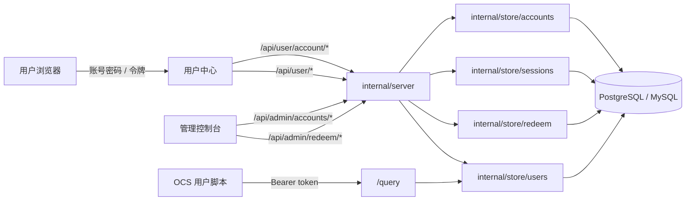
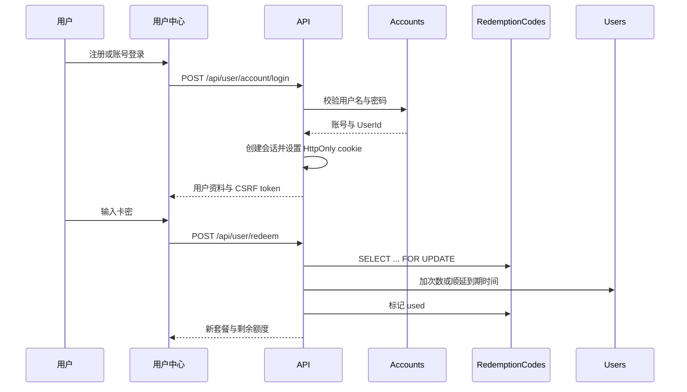

# 账号登录与卡密充值

Feature Name: 2026-10-17-account-login-recharge
Updated: 2026-10-17

## Description

在现有 token 体系上增加一层账号身份：账号用于用户中心登录与充值，token 继续作为 OCS 的调用凭据。一个账号绑定一个 token，注册时自动生成零额度 token，存量用户可以用 token 登录后绑定账号。充值通过管理员批量生成的卡密完成，额度直接加到当前账号绑定的 token 上，token 值保持不变。

设计原则：

- 查询链路不变：`/query` 仍只认 token。
- 账号登录只服务用户中心与管理控制台，使用服务端会话。
- 账号与 token 一对一，额度仍保存在现有 `Users` 行，避免重构计费模型。
- 卡密一次性使用，事务内完成校验与充值。
- 现有 token 用户零迁移成本。

## 已确认决策

- 账号与 token 一对一绑定，通过 `Accounts.UserId` 唯一索引约束。
- 新注册账号创建次数套餐用户，`TotalCount=0`、`RemainCount=0`、`UsedCount=0`，状态沿用 `exhausted`，用户中心按「未充值」文案展示。
- 卡密支持次数与时长两种类型；套餐不匹配时拒绝兑换，不做隐式切换。
- 登录页默认令牌登录；账号登录为可选入口。
- 第一版不接在线支付，不要求邮箱或手机验证。
- 密码使用 bcrypt；新增依赖 `golang.org/x/crypto/bcrypt`。

## Architecture





## Components and Interfaces

### 账号存储 `internal/store/accounts.go`

```go
type Account struct {
    ID           int64
    Username     string
    UsernameKey  string // 小写，唯一索引
    PasswordHash string
    UserID       int64
    Status       string // enabled | disabled | unbound
    CreatedAt    string
    UpdatedAt    string
    LastLoginAt  *string
}

func (s *Store) CreateAccount(username, passwordHash string, userID int64) (Account, error)
func (s *Store) GetAccountByUsername(username string) (Account, error)
func (s *Store) GetAccountByUserID(userID int64) (Account, error)
func (s *Store) BindAccount(accountID, userID int64) error
func (s *Store) UnbindAccount(accountID int64) error
func (s *Store) SetAccountPassword(accountID int64, passwordHash string) error
func (s *Store) SetAccountEnabled(accountID int64, enabled bool) error
func (s *Store) ListAccounts(query string, page, pageSize int) ([]AccountView, int64, error)
```

- `UsernameKey` 使用 `strings.ToLower(username)`，保证用户名忽略大小写唯一。
- `CreateAccount` 与用户创建在同一事务中完成；失败时回滚，避免孤儿账号或孤儿用户。
- `BindAccount` 通过 `UPDATE Accounts SET UserId=$1, Status='enabled' WHERE Id=$2 AND UserId IS NULL` 加唯一索引保证一对一；受影响行数为 0 时返回「已绑定」。
- `UnbindAccount` 把 `UserId` 置空并把状态改为 `unbound`；未绑定账号登录时返回「账号未绑定令牌」，管理员可重新绑定或删除账号。

### 会话存储 `internal/store/sessions.go`

```go
type Session struct {
    ID         int64
    AccountID  int64
    TokenHash  string
    ExpiresAt  string
    CreatedAt  string
    LastSeenAt string
    IP         string
    UserAgent  string
}

func (s *Store) CreateSession(accountID int64, tokenHash, ip, ua string, ttl time.Duration) (Session, error)
func (s *Store) GetSession(tokenHash string) (Session, error)
func (s *Store) TouchSession(id int64) error
func (s *Store) DeleteSession(tokenHash string) error
func (s *Store) DeleteAccountSessions(accountID int64) error
func (s *Store) PruneExpiredSessions() error
```

- Cookie 保存 32 字节随机值的 base64url 编码；数据库保存其 SHA-256 摘要。
- Cookie 名称 `nfentik_session`，`HttpOnly`、`SameSite=Lax`、`Path=/`、默认 30 天；HTTPS 下附加 `Secure`。
- 每次请求更新 `LastSeenAt`，采用惰性更新（每 5 分钟最多一次）避免每个请求写库。
- 密码重置、账号停用、管理员撤销会话时调用 `DeleteAccountSessions`。

### 身份解析 `internal/server/user_auth.go`

`userFromRequest` 按以下顺序解析身份：

1. `Authorization: Bearer <token>` 或 `?token=`：沿用现有 token 鉴权，供 OCS 与 API 客户端使用。
2. `nfentik_session` cookie：读取会话，加载账号绑定的用户。
3. 两者都没有时返回 `ErrUserTokenMissing`。

Bearer 优先，确保现有脚本与 API 行为稳定。账号会话只用于用户中心接口。

新增辅助函数：

```go
func (s *Server) accountFromRequest(r *http.Request) (*store.Account, error)
func (s *Server) currentUser(r *http.Request) (*store.User, error)
func (s *Server) requireCSRF(r *http.Request) error
```

### 密码与 CSRF

- 密码使用 `bcrypt.GenerateFromPassword`，cost 12；登录使用 `bcrypt.CompareHashAndPassword`。
- 密码长度 8 到 72 字节，超长直接拒绝，避免 bcrypt 截断。
- 会话登录成功后生成 CSRF token，写入非 HttpOnly cookie `nfentik_csrf` 并在响应体返回；前端在写请求头 `X-CSRF-Token` 中回传。
- 服务端对使用会话 cookie 的 `POST/PUT/DELETE` 校验请求头与 cookie 一致；Bearer 鉴权的请求跳过 CSRF 校验。
- 登录、注册、找回密码等未认证入口不要求 CSRF，但校验 `Origin` 与 `Referer` 与当前 Host 一致（存在时）。

### 卡密存储 `internal/store/redeem.go`

```go
type RedemptionBatch struct {
    ID        int64
    BatchNo   string
    Kind      string // count | duration
    PlanCode  string
    Amount    int64
    Days      int
    Quantity  int
    Note      string
    CreatedAt string
}

type RedemptionCode struct {
    ID        int64
    BatchID   int64
    CodeHash  string
    Kind      string
    Amount    int64
    Days      int
    ExpiresAt *string
    Status    string // unused | used | revoked
    UsedBy    int64
    UsedAt    *string
    CreatedAt string
}

func (s *Store) CreateRedemptionBatch(in RedemptionBatch, codes []RedemptionCode) (RedemptionBatch, error)
func (s *Store) RedeemCode(userID int64, codeHash string) (RedeemResult, error)
func (s *Store) ListRedemptionBatches(page, pageSize int) ([]RedemptionBatch, int64, error)
func (s *Store) RevokeRedemptionCode(codeID int64) error
```

- 卡密明文使用 `crypto/rand` 生成 20 个字符，字符集排除易混淆字符，例如 Crockford Base32。
- 数据库唯一索引 `CodeHash`；明文只在创建批次的响应中出现一次，管理端在创建时下载保存，后续列表只展示摘要与状态。
- `RedeemCode` 在一个事务内完成：

```text
BEGIN
  SELECT * FROM RedemptionCodes WHERE CodeHash = $1 FOR UPDATE
  校验 Status = unused 且未过期
  SELECT * FROM Users WHERE Id = $2 FOR UPDATE
  校验用户与套餐类型
  UPDATE Users 加次数或顺延到期时间
  UPDATE RedemptionCodes SET Status = used, UsedBy = $2, UsedAt = NOW()
  INSERT INTO UserAuditLogs
COMMIT
```

- 卡密行锁与用户行锁保证并发兑换只有一个事务成功，并避免两个时长卡密同时读旧到期时间导致顺延丢失。
- 兑换失败不消耗卡密，返回明确原因。

### 套餐与额度规则

| 用户当前套餐 | 次数卡密 | 时长卡密 |
| --- | --- | --- |
| 零额度账号（count 0/0/0） | 切换为次数套餐并写入额度 | 切换为时长套餐并设置到期时间 |
| 次数套餐且有额度 | 累加 TotalCount 与 RemainCount | 拒绝，提示使用时长卡密 |
| 时长套餐且未到期 | 拒绝，提示使用次数卡密 | 从当前到期时间顺延 |
| 无限套餐 | 拒绝，提示无需充值 | 拒绝，提示无需充值 |
| 已过期时长套餐 | 允许切换为次数套餐 | 从现在起重新计算到期时间 |

- 零额度判定：`PlanType=count`、`TotalCount=0`、`RemainCount=0`、`UsedCount=0`。
- 时长顺延基线：`max(now, ExpireAt)`；无限套餐的 `ExpireAt` 为空。
- 卡密不修改 `UsedCount`，只调整 `TotalCount/RemainCount/ExpireAt/PlanCode/PlanLabel`。

### 服务端接口 `internal/server/account_api.go`

用户中心：

| 方法 | 路径 | 说明 |
| --- | --- | --- |
| POST | `/api/user/register` | 注册；可选携带 token 绑定 |
| POST | `/api/user/account/login` | 账号密码登录 |
| POST | `/api/user/account/logout` | 退出并撤销会话 |
| GET | `/api/user/account/me` | 当前账号资料与绑定信息 |
| POST | `/api/user/account/bind` | 为当前 token 绑定账号 |
| POST | `/api/user/account/password` | 修改密码 |
| POST | `/api/user/redeem` | 兑换卡密 |

管理端：

| 方法 | 路径 | 说明 |
| --- | --- | --- |
| GET | `/api/admin/accounts` | 账号列表与搜索 |
| POST | `/api/admin/accounts/{id}/reset-password` | 重置密码并撤销会话 |
| POST | `/api/admin/accounts/{id}/enable` | 启用账号 |
| POST | `/api/admin/accounts/{id}/disable` | 停用账号并撤销会话 |
| POST | `/api/admin/accounts/{id}/unbind` | 解除 token 绑定并置为未绑定状态 |
| POST | `/api/admin/accounts/{id}/bind` | 把未绑定账号重新绑定到指定 token |
| POST | `/api/admin/accounts/{id}/revoke-sessions` | 撤销全部会话 |
| POST | `/api/admin/redeem/batches` | 创建卡密批次并返回一次明文 |
| GET | `/api/admin/redeem/batches` | 批次列表 |
| POST | `/api/admin/redeem/batches/{id}/revoke` | 作废该批次未使用的卡密 |

### 限流 `internal/server/ratelimit.go`

- 进程内固定窗口计数器，按 key 记录次数与重置时间，互斥锁保护。
- 注册：`register:<ip>`，每小时 5 次。
- 登录：`login:<ip>:<usernameKey>`，15 分钟 5 次失败。
- 兑换：`redeem:<userID>`，每小时 10 次失败。
- 单实例部署下足够；多实例部署需要 Redis 版本，设计预留接口。

### 用户中心前端 `web/static/user.js`、`web/templates/user.html`、`web/static/user.css`

- 登录页增加 tab，默认「令牌登录」，第二项「账号登录」。
- 注册页字段：用户名、密码、确认密码、可选 token；提交后自动登录。
- 账号中心新增：用户名、绑定 token 复制、卡密兑换输入、修改密码、退出登录。
- token 登录且未绑定时显示「绑定账号」按钮。
- 账号登录后页面刷新保持会话；前端不再把账号会话 token 写入 `sessionStorage`，token 仅用于展示与测试查询。
- 零额度或 `exhausted` 时展示充值引导文案。

### 管理控制台 `web/static/console.js`、`web/templates/console.html`

- 新增「账号管理」视图：列表、搜索、重置密码、停用/启用、解绑、撤销会话。
- 新增「卡密管理」视图：创建批次、批次列表、创建时展示一次明文、按批次作废未使用卡密。
- 系统设置增加注册开关、会话有效期、充值限流参数。

## Data Models

### Accounts

```sql
CREATE TABLE Accounts (
  Id           BIGSERIAL PRIMARY KEY,
  Username     VARCHAR(32)  NOT NULL,
  UsernameKey  VARCHAR(32)  NOT NULL,
  PasswordHash VARCHAR(100) NOT NULL,
  UserId       BIGINT       NULL,
  Status       VARCHAR(16)  NOT NULL DEFAULT 'enabled', -- enabled | disabled | unbound
  CreatedAt    TIMESTAMP    NOT NULL,
  UpdatedAt    TIMESTAMP    NOT NULL,
  LastLoginAt  TIMESTAMP    NULL
);
CREATE UNIQUE INDEX idx_accounts_username_key ON Accounts (UsernameKey);
CREATE UNIQUE INDEX idx_accounts_user_id ON Accounts (UserId);
```

### AccountSessions

```sql
CREATE TABLE AccountSessions (
  Id         BIGSERIAL PRIMARY KEY,
  AccountId  BIGINT       NOT NULL,
  TokenHash  CHAR(64)     NOT NULL,
  ExpiresAt  TEXT         NOT NULL,
  CreatedAt  TEXT         NOT NULL,
  LastSeenAt TEXT         NOT NULL,
  IP         VARCHAR(64)  NOT NULL DEFAULT '',
  UserAgent  VARCHAR(255) NOT NULL DEFAULT ''
);
CREATE UNIQUE INDEX idx_account_sessions_token ON AccountSessions (TokenHash);
CREATE INDEX idx_account_sessions_account ON AccountSessions (AccountId);
```

### RedemptionBatches 与 RedemptionCodes

```sql
CREATE TABLE RedemptionBatches (
  Id        BIGSERIAL PRIMARY KEY,
  BatchNo   VARCHAR(32) NOT NULL,
  Kind      VARCHAR(16) NOT NULL,
  PlanCode  VARCHAR(32) NOT NULL,
  Amount    BIGINT      NOT NULL DEFAULT 0,
  Days      INT         NOT NULL DEFAULT 0,
  Quantity  INT         NOT NULL,
  Note      VARCHAR(255) NOT NULL DEFAULT '',
  CreatedAt TIMESTAMP   NOT NULL
);
CREATE UNIQUE INDEX idx_redeem_batches_no ON RedemptionBatches (BatchNo);

CREATE TABLE RedemptionCodes (
  Id        BIGSERIAL PRIMARY KEY,
  BatchId   BIGINT      NOT NULL,
  CodeHash  CHAR(64)    NOT NULL,
  Kind      VARCHAR(16) NOT NULL,
  Amount    BIGINT      NOT NULL DEFAULT 0,
  Days      INT         NOT NULL DEFAULT 0,
  ExpiresAt TIMESTAMP   NULL,
  Status    VARCHAR(16) NOT NULL DEFAULT 'unused',
  UsedBy    BIGINT      NULL,
  UsedAt    TIMESTAMP   NULL,
  CreatedAt TIMESTAMP   NOT NULL
);
CREATE UNIQUE INDEX idx_redeem_codes_hash ON RedemptionCodes (CodeHash);
CREATE INDEX idx_redeem_codes_batch ON RedemptionCodes (BatchId);
CREATE INDEX idx_redeem_codes_status ON RedemptionCodes (Status);
```

MySQL 使用 `BIGINT AUTO_INCREMENT`、`DATETIME` 与 `VARCHAR(64)` 替代对应类型，迁移通过现有方言层生成。

### 设置项

账号与充值设置作为字段保存在现有 `AppSettings` JSON 中，缺省时使用默认值：

| 字段 | 默认值 | 说明 |
| --- | --- | --- |
| `accountRegistrationEnabled` | `true` | 注册开关 |
| `accountSessionTTLDays` | `30` | 会话有效期 |
| `accountLoginMaxFailures` | `5` | 登录失败上限 |
| `accountLoginWindowMinutes` | `15` | 登录失败窗口 |
| `redeemMaxFailuresPerHour` | `10` | 兑换失败上限 |

## Correctness Properties

1. **一对一绑定**：`Accounts.UserId` 唯一索引保证一个 token 最多一个账号；账号创建时必须绑定一个用户。
2. **token 不变**：绑定、注册绑定、充值与改密均不修改 `Users.Token`。
3. **额度原子性**：卡密兑换在单个事务内完成，用户额度与卡密状态同时成功或同时回滚。
4. **卡密单次使用**：`CodeHash` 唯一索引加 `FOR UPDATE` 行锁保证并发兑换只成功一次。
5. **会话可撤销**：密码重置、账号停用与主动退出都会删除服务端会话，旧 cookie 立即失效。
6. **零额度注册**：注册生成的用户初始 `TotalCount=0`、`RemainCount=0`、`UsedCount=0`，查询被拒绝。
7. **套餐不破坏**：类型不匹配的卡密在事务内被拒绝，既有额度与到期时间保持不变。
8. **来源可信**：绑定 token 必须持有该 token；卡密兑换只能作用于当前登录用户。
9. **查询兼容**：`/query` 仍只按 token 鉴权，账号会话不影响查询链路。

## Error Handling

| 场景 | 处理 |
| --- | --- |
| 用户名已占用 | `409`，返回「用户名已被占用」 |
| 密码不符合规则 | `400`，返回具体长度要求 |
| 用户名或密码错误 | `401`，统一返回「用户名或密码错误」 |
| 登录/注册/兑换过于频繁 | `429`，返回「操作过于频繁，请稍后再试」 |
| token 无效或已绑定 | `409`，返回「令牌无效或已被绑定」 |
| 账号未绑定令牌 | `409`，返回「账号未绑定令牌」 |
| 会话过期或已撤销 | `401`，清除 cookie，前端回到登录页 |
| 卡密已使用/过期/作废 | `400`，返回「卡密无效或已使用」 |
| 卡密类型与套餐不匹配 | `409`，返回对应的卡密类型提示 |
| 兑换并发冲突 | 后到事务读到 `used`，返回「卡密无效或已使用」 |
| 数据库错误 | `500`，记录日志，不返回 SQL 细节 |
| 密码哈希失败 | `500`，记录日志，不创建账号 |

## Test Strategy

- **存储层（`internal/store`）**：
  - 用户名忽略大小写唯一；账号与 token 一对一；解绑后可重新绑定其他账号。
  - 会话创建、读取、过期、撤销与按账号批量删除。
  - 卡密创建与摘要唯一；并发兑换同一卡密只有一次成功。
  - 次数卡密累加、时长卡密顺延、零额度激活、套餐不匹配拒绝。
  - 兑换失败不改变用户额度与卡密状态。
- **服务端（`internal/server`）**：
  - 注册：无 token 生成零额度用户；带 token 绑定；重复用户名、非法密码、关闭注册、限流。
  - 登录：正确密码创建会话；错误密码统一提示；失败锁定；退出撤销。
  - 身份解析：Bearer 优先于 cookie；会话过期返回 401；CSRF 校验。
  - 绑定：token 鉴权后可绑定；已绑定拒绝；解绑后原 token 仍可用。
  - 兑换：会话登录与 token 登录都可兑换；兑换后 `/api/user/me` 返回新额度。
  - 管理端：账号列表、重置密码撤销会话、停用、卡密批次与导出。
- **回归**：`go test -count=1 -p 1 ./...`；现有 token 登录、`/query` 扣费与用户中心接口保持通过。既有 `TestQueryGetAcceptsQAlias` 因未配置文本模型失败，不属于本功能回归。
- **手工验证**：注册、绑定、刷新保持登录、兑换次数卡与时长卡、错误卡密、并发兑换、退出登录。

## Migration and Rollout

1. 新增 `Accounts`、`AccountSessions`、`RedemptionBatches`、`RedemptionCodes` 四张表与索引，迁移幂等。
2. 现有 `Users` 表不变；存量用户 `Accounts.UserId` 在绑定时写入。
3. 新增设置项使用默认值，缺失时按默认值运行。
4. 前端先上线登录 tab 与注册页，再开放注册开关。
5. 管理端先生成小批量卡密验证兑换链路，再批量售卖。
6. 多实例部署前，将进程内限流替换为 Redis 限流。

## References

[^1]: (File#L17) - [用户模型与套餐字段](../nfentik-go/internal/store/users.go)
[^2]: (File#L1) - [套餐类型与状态](../nfentik-go/internal/plan/plan.go)
[^3]: (File#L1) - [用户中心鉴权](../nfentik-go/internal/server/user_auth.go)
[^4]: (File#L261) - [查询鉴权与 token 校验](../nfentik-go/internal/server/query.go)
[^5]: (File#L257) - [管理员续费入口](../nfentik-go/internal/server/admin_users.go)
[^6]: (File#L90) - [用户中心前端登录](../nfentik-go/web/static/user.js)
[^7]: (File#L1032) - [MOGO 导入控制台脚本](../nfentik-go/web/static/console.js)
