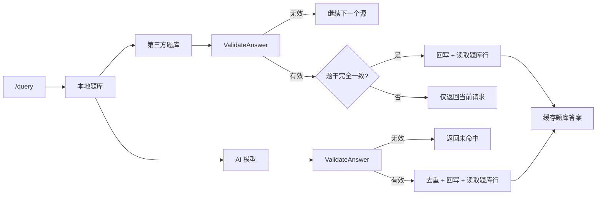

# 答案隔离与回写校验

Feature Name: 2026-10-18-answer-isolation
Updated: 2026-10-18

## Description

在查询链路写入题库与缓存之前增加三道隔离：

1. **选项校验**：选择题答案必须匹配某个选项，翻译与散文直接丢弃。
2. **URL 身份**：`QuestionHash` 纳入排序后的 URL 集合，不同图片题目不共享哈希。
3. **精确回写**：第三方答案只有题干完全一致时才回写；并发写入后以题库实际保存的答案作为响应与缓存。

这三道隔离共同解决 OCS、第三方与 AI 并发写入时的串答案问题。

## 已确认决策

- 选择题答案以选项文字入库；字母答案映射为对应选项文字。
- 第三方近似匹配只服务当前请求，不回写、不缓存。
- `QuestionHash` 追加 URL 集合，`NormalizerVersion` 从 2 升级到 3，启动时重算一次全库哈希。
- `OptionsHash` 保持历史算法，不参与本次重算。
- AI 回写后重新读取题库行，保证响应、缓存与库一致。

## Architecture



## Components and Interfaces

### 选项解析与校验 `internal/ai/choice.go`

```go
func ValidateAnswer(question string, options, queryType *string, answer string) (string, bool)
```

- `parseChoiceOptions` 支持：
  - 多行 `A. text` / `A、text` / `A) text` / `A text`
  - 单行内联 `A. text B. text C. text`
  - `###` 分隔的 MOGO 选项
  - 无字母的纯文本选项行
- `validateChoiceAnswer`：
  - 单选接受字母或选项文字，拒绝 `###` 多答案。
  - 多选支持 `###`、逗号、换行、分号与连写字母 `AC`。
  - 答案可包含少量额外文字，但必须包含某个选项文字。
- `normalizeJudgement` 把「正确/对/是/true/√/不错」归一为正确，把「错误/错/否/false/×/不对/不正确」归一为错误。

### 哈希隔离 `internal/match/hash.go`

```go
func QuestionHash(question string) string {
    urls := ExtractURLs(question)
    return digest(NormalizeQuestion(question) + "\x00" + strings.Join(urls, "\n"))
}
```

- `NormalizeQuestion` 仍把 URL 替换为 `__URL__`，供模糊匹配使用。
- `QuestionHash` 额外拼接排序后的 URL 集合；相同题面不同图片得到不同哈希。
- `OptionsHash` 改为直接哈希归一化选项文本，保持历史值不变。
- `NormalizerVersion = 3` 触发 `rehashQuestionHash`，升级后重算一次全库 `QuestionHash`。

### 查询链路 `internal/server/query.go`

- `callTextModels` 每个基础答案提取后先过 `ValidateAnswer`，无效答案不进入多数投票。
- `resolveQueryUncached` 最终答案再过 `ValidateAnswer`；无效时返回「AI未能给出有效答案」，不写库、不缓存。
- 图片题无有效答案时直接返回「请点击链接查看图片: <url>」，不把提示写入题库。
- `acceptExternal` 返回 `(answer, exact, ok)`：
  - 先过 `ValidateAnswer`。
  - 题干为空：仅可信源可返回，`exact=false`。
  - URL 集合不同：拒绝。
  - 非可信源相似度低于 0.72：拒绝。
  - `exact` 要求 `match.Score` 为 1。
- `respondExternal` 仅在 `src.WriteBack && exact` 时回写；仅 `exact` 时缓存。
- AI/第三方回写后调用 `GetQuestion(id)`，用题库实际答案构造响应与缓存；URL 身份不一致时丢弃缓存。

### 模型接口 `internal/server/model_api.go`

- `/api/model/response` 在 `save=true` 时先校验答案；不匹配返回 400 且不落库。
- `/api/model/call` 与 `/api/model/stream` 返回校验后的答案；无效时 `answer` 为空并附带提示。

### 管理端题目写入 `internal/server/admin.go`

- 新增或编辑题目时，如果提交了非空答案，先过 `ValidateAnswer`。
- 答案与题型或选项不匹配时返回 400，阻止人工把翻译误存为选择题答案。

## Data Models

本次不新增表或列。变化集中在哈希内容与回写规则：

- `AIResponses.QuestionHash`：题面归一化 + URL 集合摘要。
- `AppSettings.question_hash_version`：升级后写为 3。
- `AIResponses.OptionsHash`：保持历史算法。

## Correctness Properties

1. **选项一致**：选择题入库答案必须是某个选项文字或可解析的选项字母。
2. **URL 隔离**：不同 URL 集合的题目不共享 `QuestionHash`、缓存键、单飞键或题库行。
3. **精确回写**：第三方答案只有题干完全一致且 URL 集合相同才允许回写。
4. **并发一致**：同一题并发写入后，所有调用方以题库实际保存的答案为准。
5. **无污染缓存**：回写未成功、URL 身份不一致或答案为校验拒绝时不写缓存。
6. **历史兼容**：旧行在重算后使用新哈希；`OptionsHash` 不变。

## Error Handling

| 场景 | 处理 |
| --- | --- |
| AI 返回翻译或散文 | `ValidateAnswer` 拒绝，返回「AI未能给出有效答案」，不写库 |
| AI 返回多答案给单选题 | 拒绝 |
| 第三方近似匹配 | 返回当前请求，不回写、不缓存 |
| 第三方未返回题干且非可信 | 拒绝 |
| 第三方答案与选项不匹配 | 拒绝 |
| 不同图片 URL | 哈希不同；查询/回写均按 URL 身份隔离 |
| 并发写入同一题 | 唯一索引保证一行，回写后重新读取题库行 |
| 题库回写失败 | 不写缓存，仍返回当前答案 |
| 归一化版本升级 | 启动时重算 `QuestionHash`，日志输出开始与完成 |

## Test Strategy

- `internal/ai/choice_test.go`：
  - 翻译答案拒绝；合法选项、字母、内联/多行/无字母选项接受。
  - 单选拒绝多答案；多选支持 `###`、逗号、换行与连写字母。
  - 判断题同义表达归一。
- `internal/match/match_test.go`：
  - 相同题面不同 URL 生成不同 `QuestionHash`。
- `internal/server/external_validation_test.go`：
  - 第三方精确有效答案接受；翻译拒绝；近似匹配 `exact=false`；可信空题干接受但不精确；不同图片 URL 拒绝。
  - `/api/model/response` 保存翻译返回 400 且不落库。
- `internal/store` 与 `internal/server` 回归：
  - 现有去重、唯一索引、用户与账号测试保持通过。
  - `go test -count=1 -p 1 ./...` 仅保留既有 `TestQueryGetAcceptsQAlias` 失败。

## Migration and Rollout

1. 部署后首次启动检测到 `question_hash_version=2`，执行全库 `QuestionHash` 重算。
2. 等待日志出现「QuestionHash 重算完成」后再开放查询；重算期间服务不监听端口。
3. 重算只更新 `QuestionHash`，不修改答案、选项与 `OptionsHash`。
4. 历史错误答案不会被自动删除；本次修复阻止新错误答案入库，历史数据需要人工复核。

## References

[^1]: (File#L1) - [哈希与 URL 身份](../nfentik-go/internal/match/hash.go)
[^2]: (File#L1) - [选项校验](../nfentik-go/internal/ai/choice.go)
[^3]: (File#L411) - [第三方校验与回写](../nfentik-go/internal/server/query.go)
[^4]: (File#L490) - [AI 回写与缓存一致性](../nfentik-go/internal/server/query.go)
[^5]: (File#L265) - [模型响应保存](../nfentik-go/internal/server/model_api.go)
